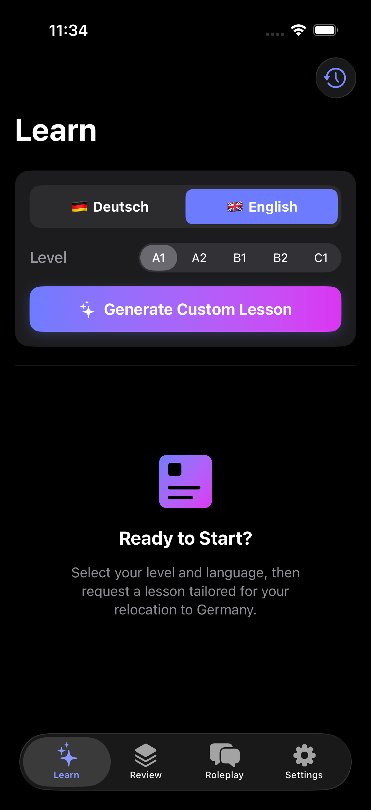
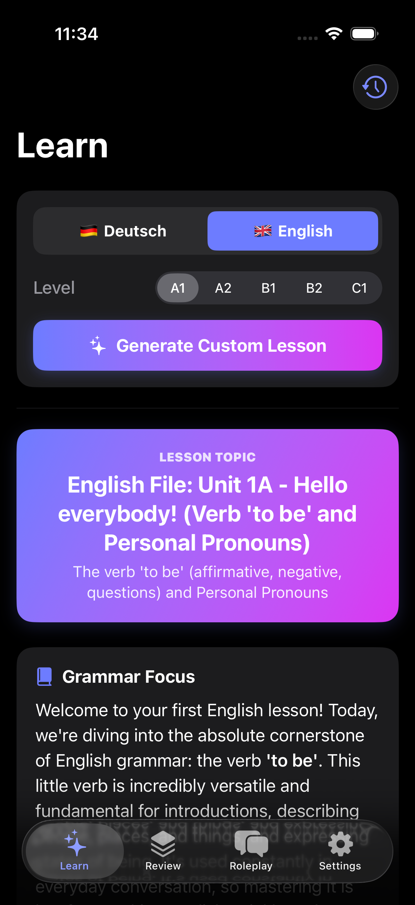
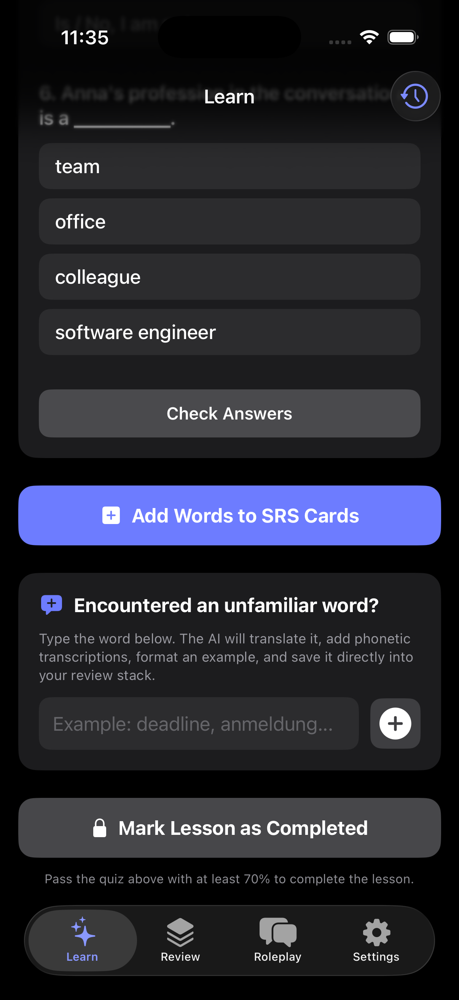
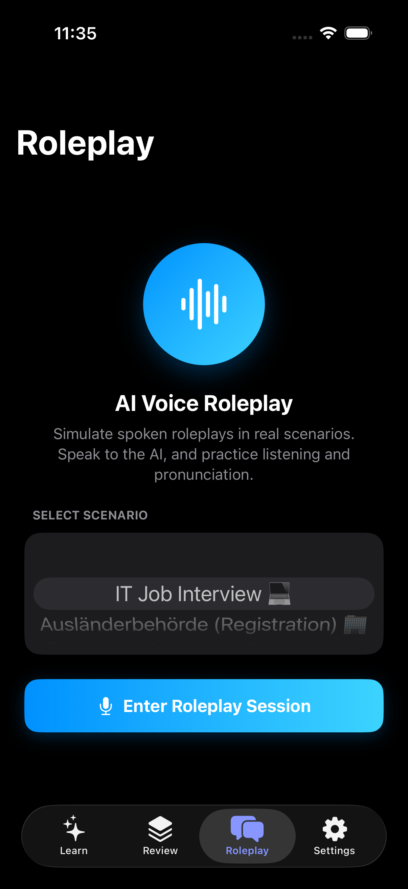

# SudyAI — AI Language Tutor for iOS

A personal iOS app for learning English and German from scratch (A1 → C1) with an AI tutor powered by Google Gemini. Lessons follow the curriculum of real textbooks (Oxford *English File* for English, Hueber *Menschen/Schritte* for German), vocabulary is retained through spaced repetition, and speaking is trained in voice roleplay sessions with error analysis.

<p align="center">
  
  
  
  
</p>

## Features

- **📚 Textbook-based lessons.** Gemini generates the next sequential unit of the course: topic, an in-depth grammar lecture in your native language (highlighting typical mistakes of Russian speakers), a real-life/IT dialogue with translation, 8–12 vocabulary words with phonetics and examples, and a 4–6 question quiz.
- **✅ Honest progress.** A lesson only counts as completed after passing its quiz with ≥70%. Moving up a level (A1 → A2 → … → C1) requires passing a final exam: 12 questions covering the whole level, 80% pass mark, retakes come with fresh questions.
- **🔁 Spaced repetition (SRS).** Lesson vocabulary is added to flashcards automatically; review scheduling uses the classic SuperMemo SM-2 algorithm.
- **🎙 Voice roleplay.** Conversations with the AI in real-life scenarios (job interview, Ausländerbehörde, apartment viewing, café, plus a random AI-generated scenario). Speech recognition (STT), spoken replies (TTS), and language complexity adapted to your CEFR level. The "Check Mistakes" button delivers a full error breakdown in your native language.
- **➕ Instant word translator.** Any unfamiliar word can be translated on the spot — with phonetics and an example sentence — and saved straight into your flashcards.
- **💾 Lesson history.** Every generated lesson is persisted locally (SwiftData) and can be reopened after restarting the app.
- **🌍 Three interface languages:** Russian, English, German. Two target languages with independent levels.

## Tech Stack

- **UI:** SwiftUI (iOS 17+)
- **Storage:** SwiftData + UserDefaults — fully local, no accounts, no backend
- **AI:** Google Gemini 2.5 Flash (REST, structured JSON output)
- **Speech:** AVSpeechSynthesizer (TTS), SFSpeechRecognizer (STT)
- **Dependencies:** none — system frameworks only

The entire app lives in a single file, `StudyIOS/StudyIOSApp.swift` (models, Gemini service, view models, screens).

## Getting Started

1. You need Xcode 16+ and an iPhone/simulator running iOS 17+.
2. Get a free Gemini API key: <https://aistudio.google.com/apikey>
3. Copy the secrets template and insert your key:
   ```bash
   cp Secrets.swift.example StudyIOS/Secrets.swift
   # open StudyIOS/Secrets.swift and replace YOUR_GEMINI_API_KEY with your key
   ```
4. Open `StudyIOS.xcodeproj`, pick a device, and hit Run.

> ⚠️ `StudyIOS/Secrets.swift` is listed in `.gitignore` — the key is never committed. Don't put your key anywhere else in the code.

## Documentation

- [docs/gemini-prompts.md](docs/gemini-prompts.md) — every prompt the app sends to Gemini, with method descriptions and response schemas.

## How Learning Works

```
Lesson (grammar + dialogue + vocabulary)
   → quiz ≥70%  → lesson completed, words go to SRS
   → daily flashcard reviews (SM-2)
   → roleplay for speaking practice + error analysis
   → final unit of the level → exam (12 questions, ≥80%) → next level
```
